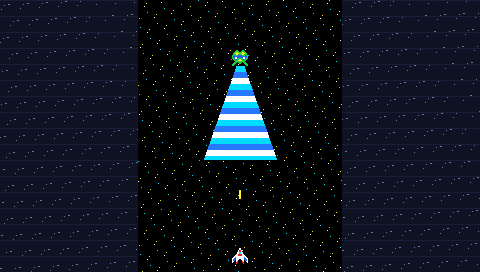

# Galaga (Arcade 1981) — Sony PSP Port

A faithful, pixel-perfect 1-player arcade recreation of Namco's 1981 classic **Galaga**, engineered natively in C++11 for the Sony PlayStation Portable (PSP) using the native PSPSDK and hardware-accelerated SDL2.



---

## Features

### 🕹️ Authentic Arcade Form Factor & Canvas Mapping
- **Original 3:4 Vertical Aspect Ratio**: Preserves the exact gameplay speed, collision geometry, and vertical progression of the original arcade cabinet by centering the active playfield in a crisp 204×272 pixel window.
- **Decorative Cabinet Side Bezels**: Fills the 16:9 widescreen blank panels with vintage arcade cabinet side art, instructional cards ("Dual Fighter Power", "Beware Tractor Beam"), live score counters, reserve ship tallies, and authentic stage badges/flags.

### 🚀 Dual-Ship Capture Mechanic
- **Boss Galaga Tractor Beam**: When Boss Galagas dive into the lower sector, they emit an animated, pulsating cyan/blue/white tractor beam.
- **Ship Capture**: If caught in the beam, your ship spins 360°, gets hoisted upward, turns red, and docks alongside the alien formation.
- **Dual Fighter Unlock**: When that Boss Galaga dives in a subsequent wave, destroy the Boss to liberate your captive ship. It descends upright, aligns with your fighter, and locks side-by-side to unleash **Dual Fighter Mode** with double firepower and dual missile salvos!
- **True Arcade Rules**: If you accidentally shoot the captive ship, it is destroyed. If the Boss is destroyed in formation, the captive ship turns hostile and attacks as a standalone dive-bomber.

### 👾 Algorithmic Flight Paths & AI Swarms
- **Entrance Formations**: Multi-stage cubic Bézier curve paths recreating the swooping loops of incoming alien swarms entering from top-left, top-right, bottom-left, and bottom-right before docking into their 50-slot formation grid.
- **Formation Breathing**: Authentic oscillating horizontal expansion and subtle breathing motions of parked enemies.
- **Dive-Bombing Attacks**: Enemies peel off from formation along dynamic swooping trajectories, target player coordinates, drop projectiles at apex, and loop back up to re-enter the grid.
- **Challenging Stages**: Every 4 stages (Stage 3, 7, 11, 15, ...), enjoy 40 enemies flying across choreographed flight paths without shooting. Tracks hit counts with an authentic score summary screen and awards a **10,000 PTS SPECIAL BONUS** for a perfect 40/40 run.

### 🔊 8-Bit Software Synthesizer
- Zero external audio assets required. All iconic Namco sounds are synthesized via real-time software audio callbacks at 22,050 Hz:
  - Player missile fire chirp (920 Hz $\to$ 300 Hz slide)
  - Crunchy alien and player explosions with debris rattle
  - Dual-tone Boss Galaga armor hits
  - Warbling frequency-modulated tractor beam pulses
  - Mournful capture siren and triumphant Dual-Fighter rescue arpeggios
  - Authentic stage start fanfares and arcade coin insert chimes

### 💾 Hardware Boundaries & Save Data
- **Memory Footprint**: Strictly constrained to a lightweight **< 16MB heap**, guaranteeing smooth 60 FPS performance on standard PSP-1000 ("Fat") models up through the PSP-Go and Street.
- **Zero In-Game Disk Reads**: All textures, starfield buffers, and sound wavetables are pre-allocated at startup for stutter-free gameplay.
- **High Score Persistence**: Automatically preserves high scores to the Memory Stick (`ms0:/PSP/SAVEDATA/GALAGA0000/hiscore.dat`).
- **Clean XMB Termination**: Soft-exit callback thread allows instantaneous return to the XMB menu at any time.

---

## Controls

| PSP Input | Arcade Function | Description |
|---|---|---|
| **D-Pad Left / Right** | Left / Right Joystick | Steers the Fighter across the bottom playfield |
| **Analog Nub** | Analog Joystick | Smooth left/right ship navigation |
| **Cross $\mathbf{[X]}$** | Fire Button | Launches missiles (Max 2 for Single, 4 for Dual) |
| **Select** | Coin Insert | Inserts arcade credit (`CREDIT +1`) |
| **Start** | 1P Start | Starts game when credits $\ge 1$ |
| **Home Button** | PSP Exit | Cleanly soft-exits back to the PSP XMB |

---

## Directory Structure

```
galaga_psp/
├── audio.hpp           # 22kHz software synth sound engine
├── bezel.hpp           # Arcade cabinet side art, stats, and stage badge renderer
├── enemy_ai.hpp        # Cubic Bézier spline matrices, swarm loops, and formation AI
├── sprites.hpp         # 16x16 pixel sprite matrices, starfield, and texture cache
├── main.cpp            # Entry point, game state loop, collision, and capture logic
├── gen_assets.py       # Pure-Python generator for ICON0, PIC1, and screenshots
├── ICON0.PNG           # 144x80 XMB icon
├── PIC1.PNG            # 480x272 XMB background wallpaper
├── screenshot.png      # In-game preview capture
├── Makefile            # PSPSDK Makefile with packaging targets
├── build.sh            # Automated compilation and ZIP packaging script
├── LICENSE             # MIT License
└── README.md           # Documentation
```

---

## Building from Source

### Prerequisites
- [PSPDEV SDK](https://github.com/pspdev/pspdev) toolchain (`psp-gcc`, `psp-g++`, `pack-pbp`, `mksfoex`).
- PSP-ported `SDL2` installed under `$PSPDEV/psp/include/SDL2`.

### Compile & Package
Run `make` to compile the PRX and generate the relocatable `EBOOT.PBP`:

```bash
make
```

To automatically package the executable into standard Memory Stick folder structure (`PSP/GAME/GalagaPSP/EBOOT.PBP`) and create the distribution archive:

```bash
make package
```

This generates `GalagaPSP_PSP.zip`.

---

## Installation on Physical PSP Hardware

1. Connect your PSP to your PC via USB or insert your Memory Stick Pro Duo.
2. Unzip `GalagaPSP_PSP.zip`.
3. Copy the `PSP` folder to the root of your Memory Stick (merging with your existing `ms0:/PSP/GAME/GalagaPSP/EBOOT.PBP`).
4. Disconnect USB and navigate to **Game $\to$ Memory Stick** on your PSP XMB.
5. Launch **Galaga (Arcade 1981)**.

---

## License

This homebrew project is released under the [MIT License](LICENSE).  
Original game concept, characters, and trademarks copyright © 1981 Namco Ltd. / Bandai Namco Entertainment.
